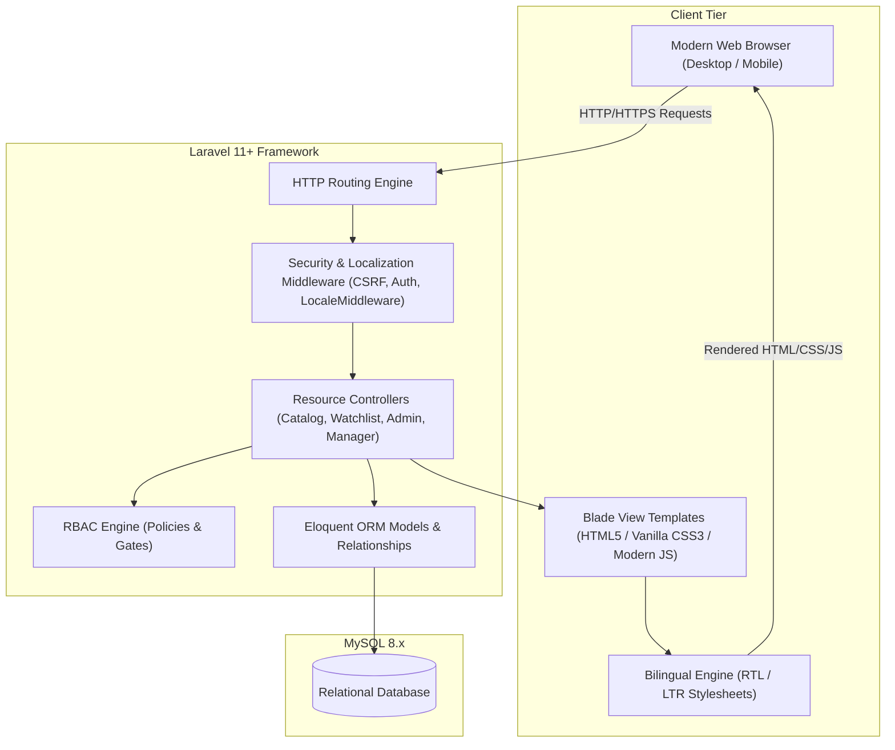
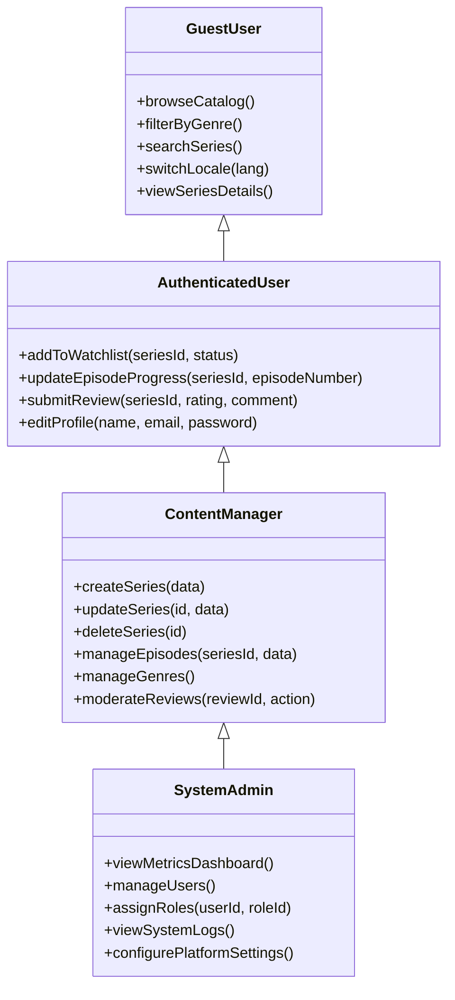
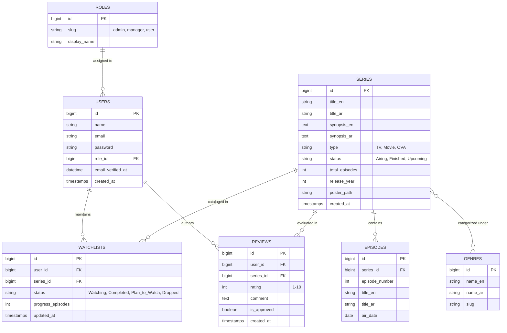

# Software Engineering Project Proposal & System Specification

**Project Title:** Media TV – Integrated American TV Series & Anime Tracking Platform  
**Course Code / Module:** CS401 – Senior Software Engineering Project  
**Date:** October 2026  
**Document Version:** 1.1.0  

---

## 1. Executive Summary & Problem Statement

### 1.1 Executive Summary
The rapid growth of the global digital streaming and serialized entertainment market has generated an unprecedented volume of episodic content, spanning both Western television drama (IMDb Top 250) and Japanese animation (Crunchyroll). While content discovery and consumption have surged, users struggle to organize, log, and maintain their viewing records across fragmented providers.

This project proposes the design and implementation of **Media TV**, an **Integrated American TV Series and Anime Tracking and Management Platform**. Built on a monolithic Model-View-Controller (MVC) architecture utilizing PHP with the Laravel framework, Blade templating, and MySQL, the platform provides a centralized, high-performance medium for catalog browsing, global searching, personalized watchlist progression tracking, and community ratings. The system features a switchable Light/Dark theme engine, bilingual internationalization (Arabic/English) with dynamic Right-to-Left (RTL) and Left-to-Right (LTR) bidirectional layout rendering, and multi-tiered Role-Based Access Control (RBAC).

### 1.2 Problem Statement
Modern media consumers face distinct operational and informational bottlenecks:
1. **Catalog Fragmentation and Tracking Fatigue:** Viewers stream content across multiple third-party providers without a unified dashboard to log watched episodes, seasonal completions, and release schedules.
2. **Inadequate Native Localization:** The majority of existing media aggregators prioritize Latin-script interfaces and English-speaking audiences. Arabic-speaking demographics are frequently marginalized with pseudo-localized translations that lack contextual fidelity, bidirectional layout support (RTL), and localized metadata.
3. **Absence of Role-Delimited Governance:** Open community platforms frequently suffer from data vandalism, spam reviews, and metadata inconsistencies due to unmoderated user privileges or overly complex administrative pipelines.
4. **Usability Barriers for Casual Viewers:** Competing platforms often require mandatory authentication prior to content discovery, alienating prospective users who wish to evaluate catalog depth before onboarding.

---

## 2. Project Objectives

The project is guided by key engineering and academic objectives:

- **Unified Progression Tracking:** Develop an intuitive state-machine pipeline enabling users to track series progression across standardized lifecycle states (`Plan to Watch`, `Watching`, `On Hold`, `Completed`, `Dropped`) with granular per-episode logging.
- **Robust Role-Based Separation of Concerns:** Establish a secure, tiered access control matrix distinguishing Unregistered Guests, Authenticated Users, Content Managers, and System Administrators.
- **Seamless Bidirectional Localization:** Implement dynamic, zero-latency switching between English (LTR) and Arabic (RTL), incorporating localized UI strings, date-time formats, and bidirectional CSS rendering.
- **Maintainable & Scalable Architecture:** Leverage Laravel's enterprise-grade conventions (Eloquent ORM, Database Migrations, Middleware pipelines, Blade Components, Form Request Validations) to deliver an extensible, academically auditable codebase.
- **Data Integrity & Content Moderation:** Ensure catalog consistency via relational referential integrity (foreign key constraints, cascading deletions) and moderation workflows for user-submitted reviews.

---

## 3. Technology Stack Justification & System Architecture

### 3.1 Backend: PHP 8.3+ & Laravel Framework
* **Architectural Pattern:** Follows the Model-View-Controller (MVC) paradigm, decoupling application business logic from presentation and database access.
* **Eloquent ORM:** Provides an object-relational mapping interface with expressive relationship definitions (`hasMany`, `belongsToMany`, polymorphic relations) preventing low-level SQL syntax coupling.
* **Security Subsystems:** Built-in safeguards including CSRF token verification middleware, prepared statements via PDO preventing SQL Injection, and secure session management.
* **Routing & Middleware Pipeline:** Enables modular request filtering for authentication (`auth`), role enforcement (`role:admin`, `role:manager`), and dynamic locale detection (`setlocale`).

### 3.2 Frontend: Blade Templating Engine, Vanilla CSS, and JavaScript
* **Laravel Blade:** Delivers clean server-side rendering (SSR) without SPA hydration overhead. Reusable component layouts (`<x-layout>`, `<x-navbar>`) standardize structural layout definitions.
* **Vanilla CSS (Modular & Custom Properties):** Employs CSS logical properties (e.g., `margin-inline-start`, `padding-inline-end`, `inset-inline-start`) ensuring seamless bi-directional typography and spacing shifts across LTR and RTL orientations without redundant stylesheets.
* **Vanilla ECMAScript (ES6+):** Lightweight DOM manipulation handles non-blocking UI interactions (AJAX watchlist incrementation, modal toggles, dynamic locale switcher).

### 3.3 Database: MySQL 8.x (Relational DBMS)
* **ACID Compliance:** Ensures transaction atomicity and consistency during composite operations (e.g., updating user watch counts while recalculating series average ratings).
* **Referential Integrity:** Enforces relational constraints (`ON DELETE CASCADE` / `ON DELETE RESTRICT`) across user profiles, watchlists, reviews, and catalog records.
* **Indexing Strategy:** Optimized indexing on frequently queried columns (`series.status`, `series.release_year`, `watchlists.user_id`, `ratings.rating_value`).

---

## 4. User Roles and Detailed Functional Requirements

The system defines four distinct actors, structured hierarchically:

---

### 4.1 Guest Users (Unregistered Visitors)

| Requirement ID | Feature Name | Description | Acceptance Criteria |
| :--- | :--- | :--- | :--- |
| **FR-GST-01** | Public Catalog Exploration | Guests can view a paginated list of all published anime and series. | Catalog loads without authentication; displays title, poster thumbnail, genre tags, and aggregated community rating score. |
| **FR-GST-02** | Multi-Faceted Filtering & Search | Guests can search items by title keywords and filter by genre, release year, and format (TV, Movie, OVA). | Query parameters are preserved across pagination; results reflect applied filters accurately. |
| **FR-GST-03** | Bilingual Locale Switching | Guests can switch interface language between Arabic (`ar`) and English (`en`) dynamically. | Toggling locale updates the session/cookie, adjusts document `lang` and `dir` attributes (`rtl`/`ltr`), and serves localized UI strings without routing disruptions. |
| **FR-GST-04** | Series Detail Inspection | Guests can view comprehensive detail pages for any series. | Displays synopsis, studio, release status, total episodes, episode guide, and public user reviews. |
| **FR-GST-05** | Authentication Redirection Gate | Restricted actions (adding to watchlist, rating, writing reviews) prompt login/registration modal or redirect. | Unauthenticated attempts to perform protected actions store intended URL and redirect to the `/login` route with a descriptive notification. |

---

### 4.2 Authenticated Users (Standard Members)

| Requirement ID | Feature Name | Description | Acceptance Criteria |
| :--- | :--- | :--- | :--- |
| **FR-USR-01** | Inherited Guest Capabilities | Users retain full access to all Guest features. | User can freely search, filter, and switch locales while authenticated. |
| **FR-USR-02** | Personal Watchlist Management | Users can add any series to their personal watchlist and assign a status (`Plan to Watch`, `Watching`, `Completed`, `On Hold`, `Dropped`). | Item is stored in `watchlists` table linking `user_id` and `series_id`. Status can be updated dynamically via standard form submit or AJAX. |
| **FR-USR-03** | Granular Episode Progression | Users can log their current watched episode count up to the series maximum. | System increments/decrements episode counter. If episode count reaches total series episodes, status prompts automatic transition to `Completed`. |
| **FR-USR-04** | Profile & Credentials Management | Users can update their screen name, registered email address, and account password. | Password updates require current password confirmation; email updates undergo uniqueness validation. |
| **FR-USR-05** | Rating & Review Submission | Users can assign an integer score (1–10) and post an optional text review for any series in the catalog. | A user may only submit one review per series (upsert logic); reviews immediately impact aggregate average calculation or enter moderation queue based on config. |

---

### 4.3 Content Manager / Content Editor

| Requirement ID | Feature Name | Description | Acceptance Criteria |
| :--- | :--- | :--- | :--- |
| **FR-MGR-01** | Series Catalog CRUD | Managers can create, update, and soft-delete anime and series catalog entries. | Forms validate mandatory metadata (English title, Arabic title, synopsis, episode count, release date, poster image upload); soft-deleted entries are restorable. |
| **FR-MGR-02** | Episode & Schedule Management | Managers can add, modify, or remove episode listings, titles, air dates, and duration for any series. | Episode numbers must remain strictly unique and sequential per series. |
| **FR-MGR-03** | Genre & Taxonomy Administration | Managers can create and organize genres and categorical tags with bilingual names. | Deleting a genre gracefully detaches associated pivot records (`series_genres`) without deleting series entities. |
| **FR-MGR-04** | Content & Feedback Moderation | Managers can inspect, approve, flag, or delete community ratings and reviews that violate platform policies. | Moderation action records the manager's audit stamp; removed reviews adjust the series' aggregate score accordingly. |

---

### 4.4 System Administrator

| Requirement ID | Feature Name | Description | Acceptance Criteria |
| :--- | :--- | :--- | :--- |
| **FR-ADM-01** | Executive Metrics Dashboard | Admins have access to a protected dashboard aggregating platform health and activity analytics. | Displays total users, active watchlists, newly registered accounts (7d/30d), total catalog titles, and most popular series. |
| **FR-ADM-02** | User Identity & Account Governance | Admins can view, search, activate, suspend, or delete user accounts across the platform. | Status changes immediately invalidate active sessions of banned accounts. |
| **FR-ADM-03** | Role-Based Privilege Assignment | Admins can promote/demote users across the role hierarchy (`User`, `Manager`, `Admin`). | Modifying roles writes an entry to administrative audit logs; admins cannot revoke their own super-admin status. |
| **FR-ADM-04** | System Oversight & Global Settings | Admins can manage global parameters (site maintenance mode, registration toggle, default pagination limits). | Changes apply system-wide through database-backed settings or Laravel configuration overrides. |

---

## 5. Non-Functional Requirements (NFR)

### 5.1 Security Requirements
- **NFR-SEC-01 (Authentication & Password Cryptography):** Passwords must be hashed using the **Bcrypt** or **Argon2id** hashing algorithm with a cost factor that prevents brute-force vulnerabilities.
- **NFR-SEC-02 (Cross-Site Request Forgery - CSRF):** Every state-altering HTTP method (`POST`, `PUT`, `PATCH`, `DELETE`) must be validated against a session-bound CSRF token via Laravel's `VerifyCsrfToken` middleware.
- **NFR-SEC-03 (SQL Injection Prevention):** Direct SQL concatenation is prohibited. All database interactions must use Eloquent ORM or parameterized PDO query builders.
- **NFR-SEC-04 (Cross-Site Scripting - XSS):** Blade automated HTML escaping (`{{ $variable }}`) must sanitize all user-generated strings (e.g., review comments, usernames) before rendering.
- **NFR-SEC-05 (Role Authorization Enforcement):** Controller endpoints must enforce strict authorization checks using Laravel Policies and Form Requests, mitigating Insecure Direct Object References (IDOR).

### 5.2 Performance & Scalability Requirements
- **NFR-PRF-01 (Page Latency):** Static and cached catalog index queries must render with a server response time (Time To First Byte - TTFB) under **300ms** under standard load.
- **NFR-PRF-02 (Query Optimization & Eager Loading):** The system must eliminate the $N+1$ query problem by systematically applying Eloquent eager loading (`with(['genres', 'ratings'])`) on all catalog and watchlist collection routes.
- **NFR-PRF-03 (Static Asset Delivery):** CSS, client-side scripts, and image assets must be minified via Vite or Laravel asset pipelines with aggressive browser caching headers configured.

### 5.3 Localization & Internationalization (i18n & a11y)
- **NFR-LOC-01 (Bi-Directional Support):** The user interface must dynamically toggle between Left-to-Right (`dir="ltr"`, English) and Right-to-Left (`dir="rtl"`, Arabic) layouts without UI overlap, broken flex containers, or distorted grid margins.
- **NFR-LOC-02 (String Externalization):** No hard-coded UI strings are permitted in view templates. All labels, buttons, validation alerts, and navigation links must reference Laravel language files (`lang/en/` and `lang/ar/`).
- **NFR-LOC-03 (Typography & Readability):** The Arabic typography must employ readable, high-legibility modern web fonts (such as Cairo, Tajawal, or IBM Plex Sans Arabic) with appropriate line-height compensation for diacritics and glyph extensions.

---

## 6. Conceptual Data Model (Entity-Relationship Overview)

---

## 7. Project Delivery Milestones

1. **Phase 1: Requirements Engineering & Database Modeling**
   - Formal SRS document finalization.
   - Conceptual ERD design, schema migration authoring, and seeding scripts.
2. **Phase 2: Authentication & Core Architecture Setup**
   - Implementation of Laravel Breeze/Fortify for foundational auth.
   - Role and permission middleware integration.
   - Dynamic locale switcher middleware and RTL stylesheet setup.
3. **Phase 3: Public Catalog & User Watchlist Implementation**
   - Media catalog browsing, filtering, and detail views.
   - Interactive user watchlist tracking and episode progress counters.
   - Review and rating submission pipeline.
4. **Phase 4: Manager & Administrator Portals**
   - Manager CRUD interfaces for series, episodes, and genres.
   - Review moderation workflows.
   - Admin metrics dashboard and user role assignment tools.
5. **Phase 5: Quality Assurance, Security Auditing & Documentation**
   - Feature and unit test implementation via PHPUnit/Pest.
   - Localization consistency review and cross-browser RTL layout validation.
   - Final academic report and presentation preparation.
